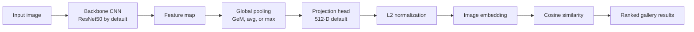
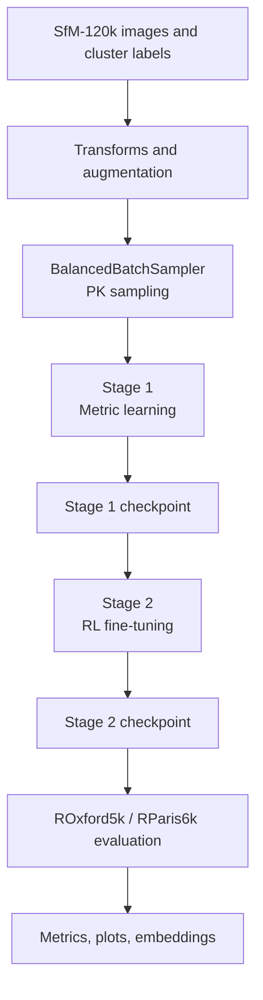
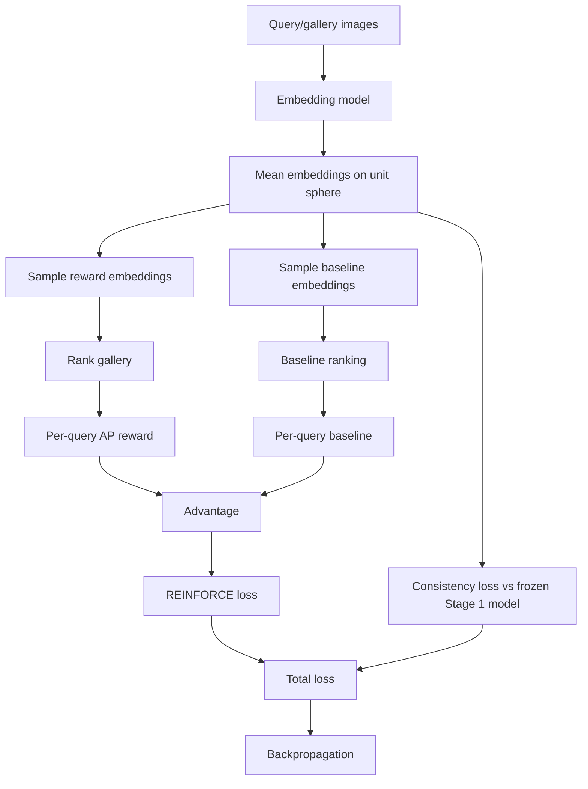

# Image Retrieval with Reinforcement Learning

Reconstruction and experimental implementation of the ideas from **"Tuning Computer Vision Models with Task Rewards"**, adapted to landmark image retrieval. The project trains an image embedding model in two stages:

1. **Stage 1: metric learning pretraining** with a differentiable proxy loss such as FastAP.
2. **Stage 2: reinforcement-learning fine-tuning** with a REINFORCE-style objective that directly rewards retrieval quality.

The final model maps each image to a normalized embedding vector. Query and gallery images are compared with cosine similarity, ranked by similarity, and evaluated with standard retrieval metrics such as mAP and Recall@K.

## What This Project Does

This repository builds a complete image retrieval training and evaluation pipeline:

- Downloads and loads landmark retrieval datasets.
- Trains a CNN embedding model with GeM pooling.
- Uses balanced PK batches so each batch contains positives and negatives.
- Pretrains with metric learning.
- Fine-tunes with a task reward using policy gradients.
- Evaluates on ROxford5k and RParis6k using Revisited benchmark protocols.
- Saves checkpoints, TensorBoard logs, JSON metrics, embeddings, and report plots.

The main experiment uses **SfM-120k** for training and validates the learned retrieval representation on **ROxford5k** and **RParis6k**.

## Repository Layout

```text
.
|-- train.py                         # Main two-stage training entry point
|-- evaluate.py                      # Revisited benchmark evaluation entry point
|-- download_dataset.py              # Dataset download helper
|-- config/
|   |-- config.yaml                  # Main experiment config
|   |-- config_stage2_combined.yaml  # Stage 2 combined reward variant
|   `-- config_stage2_map_high_consistency.yaml
|-- data/
|   |-- dataset.py                   # Generic and Revisited dataset handling
|   |-- dataset_sfm120k.py           # SfM-120k metadata/image loader
|   `-- dataloader.py                # DataLoader and balanced batch sampler
|-- models/
|   |-- backbone.py                  # Backbone factory
|   |-- pooling.py                   # Avg, max, and GeM pooling
|   `-- embedding_net.py             # Full retrieval embedding network
|-- losses/
|   |-- metric_losses.py             # Triplet, FastAP, Multi-Similarity, ArcFace
|   `-- rl_rewards.py                # mAP, Recall@K, NDCG, combined rewards
|-- training/
|   |-- trainer.py                   # Stage 1 metric learning trainer
|   `-- rl_trainer.py                # Stage 2 REINFORCE trainer
|-- evaluation/
|   |-- evaluator.py                 # Generic retrieval evaluator
|   `-- metrics.py                   # Evaluation metrics
|-- scripts/                         # SLURM jobs, plotting, reporting utilities
|-- checkpoints/                     # Saved model checkpoints
|-- logs/                            # TensorBoard and SLURM logs
`-- results/                         # Metrics, embeddings, plots, reports
```

## High-Level Architecture



The default model in `config/config.yaml` is:

- Backbone: `resnet50`
- Pooling: `gem`
- GeM power: `3.0`
- Embedding dimension: `512`
- Embedding normalization: enabled
- Input resolution: `1024 x 1024` for the main configuration

## Training Pipeline



### Stage 1: Metric Learning

Stage 1 trains the embedding model with a stable differentiable objective. The default loss is **FastAP**, configured in `config/config.yaml`:

```yaml
training:
  stage1:
    epochs: 50
    batch_size: 8
    learning_rate: 0.0001
    weight_decay: 0.0001
    optimizer: "adam"
    scheduler: "cosine"
    loss: "fastap"
    fastap_num_bins: 10
    use_amp: true
```

This stage gives the RL stage a strong retrieval initialization. RL from scratch is generally unstable for this setup because the reward is ranking based and sparse when embeddings are not already meaningful.

### Stage 2: RL Fine-Tuning

Stage 2 uses the Stage 1 model as initialization and optimizes a retrieval reward directly. In the main config, Stage 2 uses:

```yaml
training:
  stage2:
    epochs: 30
    batch_size: 8
    learning_rate: 0.000002
    weight_decay: 0.00001
    optimizer: "adam"
    algorithm: "reinforce"
    reward_metric: "map"
    reward_k: [1, 5, 10]
    baseline: "moving_average"
    baseline_momentum: 0.95
    sample_std: 0.01
    consistency_weight: 5.0
    memory_bank_size: 4096
    warmup_steps: 1000
    gradient_clip: 1.0
```

The implementation in `training/rl_trainer.py` follows this loop:

1. Split each batch into query and gallery halves.
2. Compute deterministic query/gallery embeddings.
3. Sample stochastic embeddings around the deterministic means on the unit sphere.
4. Rank gallery items by cosine similarity.
5. Compute a per-query reward, currently per-query AP for the REINFORCE update.
6. Compute a baseline, either moving average or a second independent sample.
7. Form the advantage: `reward - baseline`.
8. Apply the policy-gradient loss: `-advantage * log_prob`.
9. Add consistency regularization against a frozen Stage 1 reference model.
10. Clip gradients and update the model.
11. Update the memory bank with recent gallery embeddings.

### RL Fine-Tuning Detail



Important implementation choices:

- **Unit-sphere sampling:** embeddings are sampled and normalized, then log probability is approximated with cosine similarity scaled by `sample_std`.
- **Per-query rewards:** each query receives its own AP reward instead of using only one scalar batch reward.
- **Baseline:** the reward baseline reduces policy-gradient variance.
- **Memory bank:** recent embeddings expand the gallery beyond the current mini-batch.
- **Consistency regularization:** the Stage 2 model is discouraged from drifting too far from the Stage 1 representation.
- **BatchNorm freeze during RL:** BatchNorm layers are kept in eval mode during RL fine-tuning to preserve pretrained statistics.

## Datasets

### SfM-120k

SfM-120k is the main training dataset. It is loaded by `data/dataset_sfm120k.py`.

Expected structure:

```text
data/raw/sfm120k/
|-- retrieval-SfM-120k.pkl
|-- retrieval-SfM-120k-partial.pkl    # optional, preferred if present
`-- jpg/
    `-- <hash-based nested image paths>
```

The pickle metadata contains:

- `train.cids`: image hashes
- `train.cluster`: landmark/3D model labels
- `train.qidxs`: query indices
- `train.pidxs`: positive indices
- equivalent fields for `val`

Images with the same cluster ID are treated as positives. The loader maps cluster IDs to contiguous labels and filters missing files.

### ROxford5k and RParis6k

ROxford5k and RParis6k are used as benchmark datasets with the Revisited evaluation protocol.

Expected structure:

```text
data/raw/roxford5k/
|-- roxford5k.pkl
|-- gnd_roxford5k.pkl
`-- jpg/

data/raw/rparis6k/
|-- rparis6k.pkl
|-- gnd_rparis6k.pkl
`-- jpg/
```

Evaluation handles the Revisited `easy`, `hard`, and `junk` labels:

- Medium protocol: positives are `easy + hard`; junk is ignored.
- Hard protocol: positives are `hard`; `easy + junk` are ignored.

## Installation

The project was run in a Python/PyTorch environment with CUDA-capable hardware. The SLURM scripts use a Conda environment named `rl-env`, but any equivalent environment should work.

```bash
python3 -m venv .venv
source .venv/bin/activate
pip install --upgrade pip
pip install -r requirements.txt
```

Core dependencies include:

- PyTorch and torchvision
- NumPy, SciPy, scikit-learn
- Pillow and OpenCV
- PyYAML and OmegaConf
- TensorBoard
- FAISS CPU
- pytorch-metric-learning
- matplotlib, seaborn, pandas

## Configuration

The main configuration is `config/config.yaml`.

Key sections:

- `dataset`: dataset name, root path, image size, eval query size
- `model`: architecture, pooling, embedding dimension
- `training.stage1`: metric-learning hyperparameters
- `training.stage2`: RL hyperparameters
- `augmentation`: train/eval image transforms
- `mining`: mining strategy metadata
- `evaluation`: metrics and retrieval options
- `system`: device, workers, output directories
- `logging`: TensorBoard/W&B settings

The project also includes Stage 2 ablation configs:

- `config/config_stage2_map_high_consistency.yaml`: mAP reward with stronger consistency weight.
- `config/config_stage2_combined.yaml`: combined reward, `0.5 * mAP + 0.5 * mean(Recall@K)`, with stronger consistency.

## Running Training

### Full Two-Stage Training

```bash
python train.py --config config/config.yaml
```

This runs Stage 1 followed by Stage 2.

### Stage 1 Only

```bash
python train.py --config config/config.yaml --stage1_only
```

### Stage 2 Only From a Stage 1 Checkpoint

```bash
python train.py \
  --config config/config.yaml \
  --stage2_only \
  --resume checkpoints/stage1_epoch_13_best.pth
```

### Override Epoch Counts

```bash
python train.py \
  --config config/config.yaml \
  --stage1_epochs 15 \
  --stage2_epochs 3
```

### SLURM Training

The repository includes SLURM scripts for cluster execution:

```bash
sbatch scripts/train_job.sh
```

Other useful scripts:

- `scripts/submit_job.sh`
- `scripts/submit_stage2_from_stage1_epoch35.sh`
- `scripts/run_stage2_alternatives.sh`
- `scripts/train_with_tensorboard.sh`
- `scripts/start_tensorboard.sh`

## Evaluation

Evaluate a checkpoint on the dataset from the config:

```bash
python evaluate.py \
  --checkpoint checkpoints/stage2_20260406_173128/stage2_best_roxford.pth \
  --config config/config.yaml
```

Evaluate on a specific benchmark:

```bash
python evaluate.py \
  --checkpoint checkpoints/stage2_20260406_173128/stage2_best_roxford.pth \
  --config config/config.yaml \
  --dataset roxford5k \
  --stage stage2 \
  --save_embeddings \
  --save_eval_plots
```

The evaluator saves:

- `metrics.json`
- timestamped `metrics_*.json`
- optional `embeddings.npz`
- optional evaluation plots

## Results and Findings

The saved metrics show that Stage 2 RL fine-tuning improved benchmark retrieval performance over Stage 1 on both ROxford5k and RParis6k.

### Final Benchmark Metrics

| Dataset | Stage | mAP Medium | mAP Hard | Recall@1 Medium | Recall@5 Medium | Recall@10 Medium | Recall@1 Hard | Recall@5 Hard | Recall@10 Hard |
|---|---:|---:|---:|---:|---:|---:|---:|---:|---:|
| ROxford5k | Stage 1 | 0.1697 | 0.0359 | 0.0052 | 0.0330 | 0.0605 | 0.0001 | 0.0047 | 0.0151 |
| ROxford5k | Stage 2 | 0.2012 | 0.0680 | 0.0126 | 0.0592 | 0.1000 | 0.0158 | 0.0565 | 0.0816 |
| RParis6k | Stage 1 | 0.4081 | 0.1626 | 0.0049 | 0.0232 | 0.0456 | 0.0067 | 0.0242 | 0.0400 |
| RParis6k | Stage 2 | 0.4613 | 0.2156 | 0.0051 | 0.0239 | 0.0461 | 0.0066 | 0.0274 | 0.0500 |

### Relative Improvements

| Dataset | Metric | Stage 1 | Stage 2 | Absolute Change | Relative Change |
|---|---|---:|---:|---:|---:|
| ROxford5k | mAP Medium | 0.1697 | 0.2012 | +0.0316 | +18.6% |
| ROxford5k | mAP Hard | 0.0359 | 0.0680 | +0.0321 | +89.4% |
| ROxford5k | Recall@10 Medium | 0.0605 | 0.1000 | +0.0395 | +65.3% |
| ROxford5k | Recall@10 Hard | 0.0151 | 0.0816 | +0.0665 | +439.5% |
| RParis6k | mAP Medium | 0.4081 | 0.4613 | +0.0531 | +13.0% |
| RParis6k | mAP Hard | 0.1626 | 0.2156 | +0.0530 | +32.6% |
| RParis6k | Recall@10 Medium | 0.0456 | 0.0461 | +0.0005 | +1.0% |
| RParis6k | Recall@10 Hard | 0.0400 | 0.0500 | +0.0100 | +25.0% |

### Main Findings

1. **RL fine-tuning improved mAP on both evaluation datasets.**  
   ROxford5k mAP Medium increased from `0.1697` to `0.2012`, while RParis6k mAP Medium increased from `0.4081` to `0.4613`.

2. **The strongest gains were on hard protocols.**  
   ROxford5k mAP Hard almost doubled, increasing from `0.0359` to `0.0680`. RParis6k mAP Hard improved from `0.1626` to `0.2156`.

3. **ROxford5k Recall@K improved substantially after Stage 2.**  
   Recall@10 Medium increased from `0.0605` to `0.1000`, and Recall@10 Hard increased from `0.0151` to `0.0816`.

4. **RParis6k mAP improved more clearly than Recall@K.**  
   The ranking quality improved, especially in mAP, while medium Recall@K changed only slightly. This suggests Stage 2 often moved relevant images higher throughout the ranking without always changing whether a relevant item appeared in the very top K.

5. **The RL reward was learnable and increased during Stage 2.**  
   In the 30-epoch Stage 2 run under `results/stage2_20260406_173128`, train reward increased from about `0.4733` to `0.5664`.

6. **ROxford benchmark monitoring showed early and mid-training gains.**  
   During the `stage2_20260406_173128` run, ROxford5k mAP Medium rose from `0.1865` at epoch 1 to a best logged value of `0.2520` at epoch 18 before later fluctuation.

7. **The baseline tracked reward closely.**  
   Saved Stage 2 histories show the moving/sample baseline stayed near the reward curve, which is important for keeping policy-gradient updates from becoming too noisy.

## Saved Artifacts

Important checkpoints:

```text
checkpoints/stage1_epoch_13_best.pth
checkpoints/stage1_20260405_073610/stage1_epoch_30.pth
checkpoints/stage1_20260405_073610/stage1_epoch_35.pth
checkpoints/stage2_20260406_173128/stage2_best_roxford.pth
checkpoints/stage2_20260417_231413/stage2_best_roxford.pth
```

Important metric files:

```text
results/eval_stage1/roxford5k/metrics.json
results/eval_stage1/rparis6k/metrics.json
results/eval_stage2/roxford5k/metrics.json
results/eval_stage2/rparis6k/metrics.json
results/stage2_20260406_173128/stage2_metrics_20260407_125835.json
results/stage2_20260417_231413/stage2_metrics_20260418_223339.json
```

Report plots:

```text
results/plots/figure3_stage2_training_curves.png
results/plots/figure4_reward_baseline_dynamics.png
results/plots/figure5_recall_at_k_comparison.png
results/plots/figure6_qualitative_retrieval_examples.png
results/plots/stage1_vs_stage2_benchmark_bar_chart.png
results/plots/report_stage1_vs_stage2_recall.png
results/plots/report_stage2_dynamics.png
results/plots/report_qualitative_roxford.png
```

## Plot and Report Utilities

The `scripts/` directory contains utilities for creating result figures:

```bash
python scripts/plot_stage2_training_curves.py
python scripts/plot_reward_baseline_dynamics.py
python scripts/plot_recall_comparison.py
python scripts/plot_stage_benchmark_bars.py
python scripts/plot_qualitative_retrieval_examples.py
python scripts/generate_report_plots.py
```

These scripts generate the figures stored in `results/plots/`.

## TensorBoard

Training logs are written to `logs/` as TensorBoard event files.

```bash
tensorboard --logdir logs
```

or:

```bash
bash scripts/start_tensorboard.sh
```

Useful logged quantities include:

- `train/loss`
- `val/loss`
- `train/rl_loss`
- `train/reward`
- `train/baseline`
- `train/advantage`
- `val/reward`

## Implementation Notes

### Balanced Batches

Metric learning and RL reward computation both need positives and negatives inside a batch. `BalancedBatchSampler` samples:

- `P` classes per batch
- `K` images per class
- batch size = `P * K`

This makes in-batch AP, recall, and triplet-style losses meaningful.

### Memory Bank

In Stage 2, a mini-batch gallery can be too small and easy. `EmbeddingMemoryBank` keeps recent gallery embeddings in a FIFO queue and concatenates them with the current gallery before reward computation. This gives the reward function a larger and harder retrieval set.

### Consistency Regularization

Stage 2 keeps a frozen copy of the Stage 1 model. The RL model is penalized if its deterministic query/gallery embeddings drift too far from the Stage 1 embeddings:

```text
total_loss = policy_loss + consistency_weight * consistency_loss
```

This helped keep RL fine-tuning stable while still allowing task-reward improvements.

### Revisited Evaluation

`evaluate.py` computes:

- mAP Medium
- mAP Hard
- Recall@1/5/10 Medium
- Recall@1/5/10 Hard

The ranking is based on:

```text
similarity = query_embeddings @ gallery_embeddings.T
```

because embeddings are L2-normalized.

## Reproducibility Checklist

1. Install dependencies from `requirements.txt`.
2. Place datasets under `data/raw/`.
3. Confirm `config/config.yaml` paths match the machine.
4. Run Stage 1 or use an existing Stage 1 checkpoint.
5. Run Stage 2 with `--stage2_only --resume <stage1 checkpoint>` if continuing from a pretrained model.
6. Evaluate Stage 1 and Stage 2 checkpoints on both benchmarks.
7. Regenerate plots from saved JSON metrics.

Example:

```bash
python train.py --config config/config.yaml --stage1_only

python train.py \
  --config config/config.yaml \
  --stage2_only \
  --resume checkpoints/stage1_epoch_13_best.pth

python evaluate.py \
  --checkpoint checkpoints/stage2_20260406_173128/stage2_best_roxford.pth \
  --config config/config.yaml \
  --dataset roxford5k \
  --stage stage2 \
  --save_embeddings
```

## Known Limitations and Future Work

- The absolute benchmark scores are below heavily engineered retrieval systems; this project focuses on reconstructing and testing the task-reward tuning idea rather than matching state of the art.
- Stage 2 policy-gradient loss is noisy by nature. Baselines, consistency regularization, low learning rates, and the memory bank are important.
- Recall@K gains were stronger on ROxford5k than RParis6k; future work could tune reward composition per dataset.
- The current Stage 2 per-example reward uses AP. The code also supports recall, NDCG, and a combined reward, but those variants should be compared systematically.
- Query expansion, database augmentation, whitening, diffusion, and reranking are disabled in the current evaluation config.
- More seeds are needed to report confidence intervals.

## Project Summary

This project successfully reconstructs a two-stage task-reward tuning pipeline for image retrieval. A ResNet50+GeM embedding model is first trained with a metric-learning objective and then fine-tuned with a direct retrieval reward. The saved experiments show that RL fine-tuning improved mAP on both ROxford5k and RParis6k, with especially strong gains on hard retrieval protocols.

